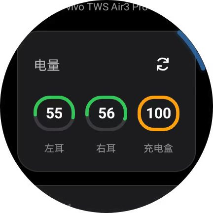
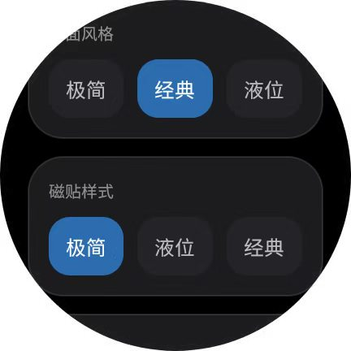

# WearEars 🎧⌚

> 原项目名 `tws-control-for-wear`，现已重构并更名为 **WearEars**。

[](https://github.com/hdzw1155/WearEars/releases)
[](https://github.com/hdzw1155/WearEars/blob/main/LICENSE)


在 **Wear OS 3+ 手表**和 **Android 11+ 手机**上跨品牌查看 TWS 蓝牙耳机电量、切换降噪与音效的开源工具（应用 ID：`com.hdz.wearcontrol`，当前版本：`0.5.0-exp-B` / `versionCode 17`，最低 API 30，目标 API 34）。纯本地蓝牙通信，不联网、不收集也不上传任何数据。

> ⚠️ **风险提示**：本项目部分品牌协议来自社区逆向资料，并包含大量 AI 辅助编写的代码。私有蓝牙指令未经原厂授权，切换实验性功能或响铃寻机时存在突发爆音、音量突变、固件异常甚至损坏设备的风险。**首次试用新机型或点击标有「实验」的功能前，请务必摘下耳机并调低系统音量。**

---

## 0.5.0-exp-B 做了什么更新

相比早期的 `0.4.x` 版本，0.5.0系列重构了底层通信、功能框架、界面与手机端兼容性；本次 `0.5.0-exp-B`（`versionCode 17`）进一步落地手机端快撤短连接与红队审计修复：

1. **手机端「900ms/450ms快撤+软待命」按需短连接（解决同品牌手机秒踢断连）**
   - 同品牌手机（ColorOS/OriginOS/HyperOS/HarmonyOS）的系统耳机服务优先级更高，往往在1~2秒内踢掉第三方App的RFCOMM通道，导致界面在「已连接↔未连接」之间反复闪跳。
   - `0.5.0-exp-B`在手机端默认启用新版快撤短连接：收齐首屏有效状态后空闲900毫秒自动归还通道进入「按需待命」，点击控制项自动重连并在确认后450毫秒快撤（响铃寻机期间不提前归还）。即便在已同步状态下被系统提前踢断，也会平滑吸收为「按需待命」而不清屏重连，界面数据完整保留。
   - 配合12秒稳定存活门禁避免重连耗电风暴；异品牌手机可在设置页「手机连接策略」切回「持续长连接」，手表端保持常连逻辑不变。
2. **红队安全与协议加固（0.5.0-exp-B重点修复）**
   - **Neo磁贴电量修复**：补齐新极简、新经典、新液位三套磁贴缓存键中的连接态编码，修复此前因默认传入未知连接态导致磁贴电量被清零的问题。
   - **查找耳机与待命态安全**：进入或唤醒「按需待命」时强制清空旧佩戴状态与实时确认位，等待新会话重新确认后再下发指令；修复小米响铃ACK到达前耳机已入耳的竞态，触发入耳立即下发停响；修复查找弹窗列表主题适配与音频/空间实验室多处边界竞态。
   - **OPPO/小米/华为/Sony协议加固**：收紧OPPO `OPOv1`编码范围与LEB128长度边界、单耳佩戴未知判空与能力位清理；收紧小米RCSP配置ID与TLV长度校验；修正华为空间音频默认开启为固定模式（避免误开头部追踪）、电量TLV合法性校验与佩戴未知态处理；修复Sony写队列上限与过期回调清理。
3. **通用特性引擎：更多耳机进阶功能直接上主界面**
   - 在降噪三态与电量之外，统一建模了**降噪细分档位、通透子模式、抗风噪、内置 EQ / vivo DeepX、耳机硬件空间音频与头部追踪、游戏低延迟、双设备连接、佩戴检测/状态、查找耳机、固件版本**。
   - 不再把内置 EQ 和硬件空间音频藏在“连点 5 下开发者设置”里，按设备实际探测结果直接显示在主界面 / 至上分页；未真机完整验证的条目统一标 `实验` 徽章，首次点击弹出听觉安全确认。
   - 修复了同时支持抗风噪和降噪细分档位时细分档位被顶掉或点不动的问题，以及手表小圆屏下 `实验` 徽章文字被挤扁的问题。
4. **本机单端空间音频 + 360° 双耳 HRTF 实验室**
   - **明确区分边界**：主界面严格把「耳机硬件空间音频（厂商私有协议）」和「手表 / 手机空间音频（单端）」分栏标注。本机单端空间音频**只作用于当前安装 WearEars 这台设备本机播放的媒体音频**；如果手机在播歌、手表只当遥控器，手表端的本机空间音频不会生效。
   - **本机单端 DSP**：基于 Android `DynamicsProcessing`（10 段 Pre-EQ + 3 段多段压缩 + 限幅）、会话级插入式 `EnvironmentalReverb`（绝不在全局 session 0 挂混响）与探测式 `Virtualizer`，提供「自然宽阔 / 影院 / 音乐厅 / 人声棚」4 种声场，任意蓝牙耳机可用。
   - **防叠加仲裁**：检测到耳机硬件空间音频或系统自带 `Spatializer` 开启时自动旁路，避免双重空间化失真。
   - **360° 双耳 HRTF 实验室**：内置纯 Java 11 零 GC 48 kHz 双耳声学内核（ITD / ILD / 耳廓陷波 / 早反射与 Hadamard FDN）与内置试听音源，手表支持表冠 15° 刻度调节，手机支持触屏拖拽。
5. **四套皮肤统一 & 双端适配**
   - 统一了 **至上（Suprematist）、新极简、新经典、新液位** 四套界面的主屏、设置页、空间实验室与弹窗风格，支持设置页日夜切换与中英文切换。
   - 手机端自动切为 480dp 居中列、原生垂直滚动条和「至上」底部翻页条，修复了 Android 11 手机启动时的 `AppScrollView` 空指针闪退。
6. **多层安全门禁与耗电治理**
   - **查找耳机三层保护**：检测到入耳时直接拦截响铃 → 发声前弹出听力安全确认 → 响铃中提供一键停止窗、30 秒自动停响，以及放回耳中/断连/切后台时的实时急停。
   - **70% 音量护栏**：进入和离开界面自动上锁（锁定时只能调小）；超过 70% 需二次确认；如果通过实体键把音量调回 70% 以下，会自动撤销之前的高音量授权。
   - **省电优化**：零 WakeLock、零常驻前台服务、零后台 BLE 扫描；切后台立即断链并停动画；手机端彻底跳过 Wear OS 磁贴蓝牙广播唤醒；本机空间音频 DSP 在音乐暂停 45 秒后自动释放（含外部播放器暂停但不关闭 AudioSession 的场景）。

---

## 📸 界面预览

> 下图为早期 0.3.5 / 0.4.x 手表端实拍参考，`0.5.0-exp-B` 在此基础上统一了至上、新极简、新经典、新液位四套皮肤并补充了手机竖屏与进阶功能面板。

<table>
  <tr>
    <td><br><div align="center">经典主界面</div></td>
    <td><br><div align="center">极简主界面</div></td>
    <td><br><div align="center">液位主界面</div></td>
  </tr>
  <tr>
    <td><br><div align="center">经典磁贴</div></td>
    <td><br><div align="center">液位磁贴</div></td>
    <td><br><div align="center">极简磁贴</div></td>
  </tr>
  <tr>
    <td colspan="3" align="center"><br/><div align="center">设置页参考</div></td>
  </tr>
</table>

---

## 📊 品牌支持与验证边界

请区分三类来源：**历史真机验证基线**（旧版实测通过的基础链路与降噪/电量）、**开源资料扩展**（`0.5.0-exp` 新增的细分档位/抗风噪/EQ/扩展开关，未逐一真机验收前一律视为实验性），以及**标准蓝牙兜底**。

| 耳机品牌 | 传输方式 | 基础控制（降噪 / 电量） | 扩展特性（按探测开放，多为实验性） | 验证状态 |
| --- | --- | --- | --- | --- |
| **vivo / iQOO** | RFCOMM (GAIA) | 三态降噪 / 左中右电量 | 降噪档位、DeepX/EQ、空间音频、低延迟、佩戴、查找、固件 | ✅ 历史真机：vivo TWS Air3 Pro（扩展项待全量复测） |
| **华为 FreeBuds / 荣耀 HONOR** | RFCOMM (SPP) | 三态降噪 / 左中右电量（含充电） | 降噪档位、抗风噪、通透人声、内置 EQ、低延迟、佩戴、空间音频（HONOR 隔离不发不兼容帧） | ✅ 历史真机：FreeBuds 6i、SE 4 ANC、HONOR Earbuds X9 |
| **小米 / Redmi Buds** | RFCOMM (RCSP / MMA) | 按型号确认三态 / 左中右电量 | 降噪档位、自适应、通透、低延迟、双设备、佩戴、查找、空间音频（6 Play / 6 Active 禁用降噪） | ✅ 历史真机：Redmi Buds 6；其余型号实验性 |
| **OPPO / 一加 / realme** | RFCOMM (OPOv1) | 三态降噪 / 左中右电量（含充电） | 降噪档位、抗风噪（经能力回包确认后开放）、EQ、空间音频、低延迟、佩戴、查找 | ✅ 历史真机：Enco Air5 Pro、Enco Free4 |
| **原道 NiceHCK** | RFCOMM (SPP) | 三态降噪 / 左中右电量 | 降噪深度、抗风噪等（按固件版本门控） | ✅ 历史真机：OriG in 原道原点 |
| **Sony 指定 WH / WF** | RFCOMM (MDR V1/V2) | 回包确认三态 / 整机或分体电量 | 通透/语音聚焦、佩戴检测、多点等（按 V2 能力探测） | ✅ 历史真机：WF-1000XM5；其余候选型号实验性 |
| **漫步者 EDIFIER** | RFCOMM (SPP) / BLE GATT | 按 group 映射（未知只读） / 电量 | 降噪深度、抗风噪、低延迟 | ⚠️ 实验性（社区资料实现，未真机验证） |
| **弱水时砂 RoseLink** | BLE GATT / RFCOMM | 按型号族映射 / 左中右电量 | 入耳检测、低延迟等 | ⚠️ 实验性（社区资料实现，未真机验证） |
| **Technics EAH-AZ** | RFCOMM (RACE) | 回包确认三态 / 左中右电量 | 降噪/通透强度等（不含 A800） | ⚠️ 实验性（社区资料实现，未真机验证） |
| **其他蓝牙耳机** | 系统蓝牙 Profile + 广播 | 仅整机总电量（只读，不发私有指令） | 支持本机单端空间音频与 360° 实验室 | ⚠️ 标准兜底 |

> 九个品牌驱动均可在构建期按需裁剪，未知品牌或无私有链路时自动退回系统标准蓝牙状态，不会向陌生耳机盲发私有指令。

---

## 🚀 安装与使用

手表和手机共用同一个 APK（请前往 [Releases](https://github.com/hdzw1155/WearEars/releases) 下载，优先选择带版本号、以 `.apk` 结尾的文件，如 `WearEars-0.5.0-exp-B.apk`）：

1. **先配对耳机**：在手表或手机的系统蓝牙里正常连上耳机。
2. **安装 APK**：
   - **Android 手机**：直接点击 APK 安装。
   - **Wear OS 手表**：用手机上的 **WearOS 工具箱** / 水滴助手 / Bugjaeger 通过无线调试安装，或电脑执行 `adb install -r WearEars-0.5.0-exp-B.apk`。
   - **注意两个常见安装坑**：
     1. 反复下载同名包时，手机或工具箱可能会把文件重命名为 `.apk.1`，ADB 会直接拒装——确保文件名以 `.apk` 结尾。
     2. 官方 Release 发布的 `WearEars-0.5.0-exp-B.apk` 延续了 `v0.4.x` / `v0.5.0-exp` 签名，可直接覆盖升级；如果设备上装着自行编译的本地调试包并提示签名冲突，请先卸载旧版再装新版。
3. **首次启动与磁贴**：首次打开或跨 `versionCode` 升级需确认免责声明；手表端可在磁贴列表添加「耳机控制」磁贴。

---

## 🛠️ 在 Windows 离线构建与裁剪驱动

开发与架构详情请先看 [底层架构与交接](docs/HANDOFF.md) 和 [按问题查文件](docs/FILE_MAP.md)。

环境要求：Python 3.9+（`py` 启动器）、JDK 17、Android SDK Platform 34、Build Tools 34.0.0。默认 JDK 目录 `%USERPROFILE%\android-tools\jdk-ms`，SDK 目录 `%LOCALAPPDATA%\Android\Sdk`（可用环境变量 `WEAREARS_JDK` 和 `ANDROID_SDK_ROOT` 覆盖）。Wear Tiles 等离线 jar 已随仓附带，无需联网拉取 Gradle 依赖。

```powershell
# 运行纯核心规则单测
py -X utf8 build.py core

# 运行全部 16 套 JVM / 平台适配层测试（含 234 组中英文文案对等检查）
py -X utf8 build.py test

# 全量测试 + 构建 APK + zipalign + apksigner 签名校验（产物：build/WearEars.apk）
py -X utf8 build.py verify
```

按需裁剪品牌驱动打包：

```powershell
py -X utf8 build.py apk --drivers none
py -X utf8 build.py apk --drivers vivo,huawei,xiaomi,oppo
```

首次构建会在 `.local/debug.p12` 生成本地调试密钥（不入库）。如需自定义发布签名，可设置 `WEAREARS_KEYSTORE`、`WEAREARS_KEY_ALIAS`、`WEAREARS_STORE_PASS`（必要时加 `WEAREARS_KEY_PASS`）。

---

## ⚠️ 免责声明与开源致谢

- 本项目为非官方第三方社区开源工具，仅供个人学习与技术交流，与 vivo / 华为 / 荣耀 / 小米 / OPPO / 一加 / realme / 漫步者 / 弱水时砂 / 原道 / Sony / Technics 及其关联公司无任何隶属或授权关系。
- 按现状提供，不作任何明示或默示担保；因使用本项目引发的设备异常、听力不适或保修问题由使用者自行承担。
- 协议资料参考自开源社区公开逆向文档与项目：TWS-Pods-PC、HyperEars、Pods-Protocol-Reverse、QuickBuds、SonyHeadphonesClient、redmi-buds-linux、OpenXia、omarchy-headphones、RoseLink-Protocol、rosebuds、NiceHCK_Controller 及其 Windows 实现、OpenFreebuds 等。完整上游归属见 [NOTICE](NOTICE)，离线依赖许可见 [vendor/NOTICE.md](vendor/NOTICE.md)。
- 源码许可证：[MIT](LICENSE)。
