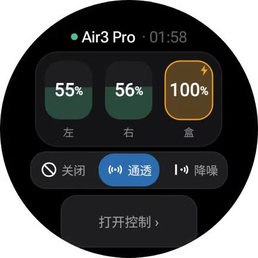
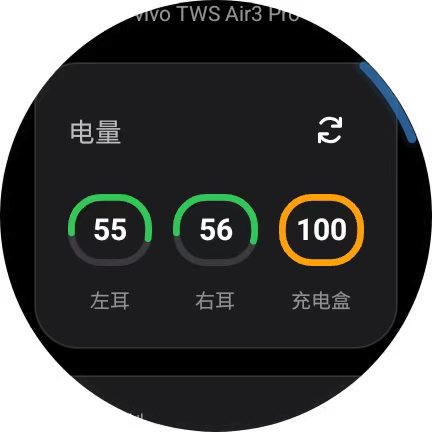
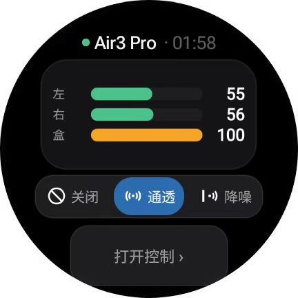
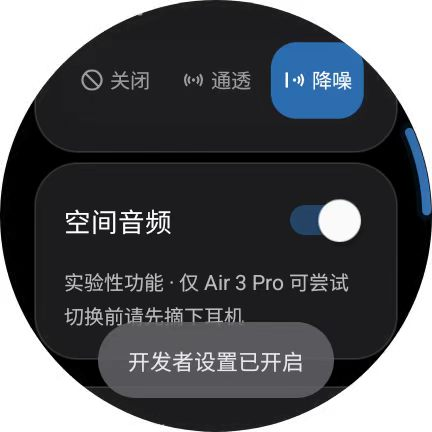
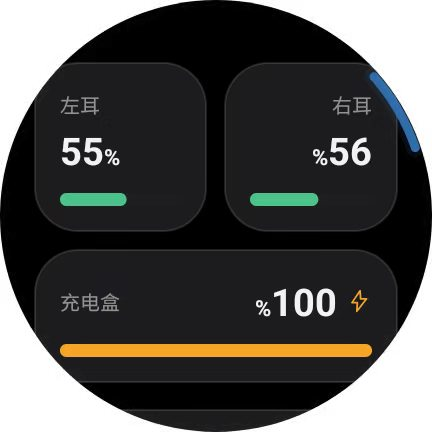
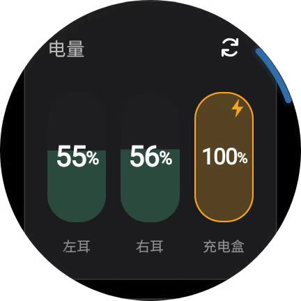

# WearEars 🎧⌚

> 项目原名 `tws-control-for-wear`，2026-10 起更名为 **WearEars**；旧的仓库链接会自动跳转到新地址。

[](https://github.com/hdzw1155/WearEars/releases)
[](https://github.com/hdzw1155/WearEars/blob/main/LICENSE)


> ⚠️ **AI 风险警告**：本项目深度依赖 AI 生成代码与逆向的私有蓝牙协议，AI 可能给出错误指令——**存在不可挽回地损坏你的耳机、手表或其他设备，以及造成听力损伤、数据丢失的风险**。实验性操作前请务必摘下耳机并调低音量，详见下方免责声明。

**我们的目标是：让 Wear OS 手表用户都能跨品牌控制、适配自己的 TWS 蓝牙耳机。**

不用羡慕原厂全家桶生态——在 **Wear OS 3+ 手表**（如三星 Galaxy Watch 等）上，你可以**不依赖手机**，通过蓝牙切换耳机的降噪/通透模式、查看左/右耳与充电盒电量；耳机通常还能同时保持与手机的正常音频连接。

更进一步，这是一个**为 AI 自由适配而生**的开源项目：哪怕你完全不会写代码，也可以尝试把本页面和手头耳机的开源协议资料一并丢给 AI，让它照着项目内置的填空骨架帮你生成专属耳机驱动——**欢迎所有人 Fork、魔改、适配你自己的耳机！**

> 💡 **项目背景与三不原则**：本项目是单品牌前作 [vivo-tws-watch-control](https://github.com/hdzw1155/vivo-tws-watch-control) 的多品牌重构版。**个人免费开源、不收集不上传任何数据、严禁任何形式的商业倒卖**（禁止在闲鱼/淘宝/付费群等打包收费或付费代装）。

## 📊 当前支持情况与核心功能

* **手表端**：实测三星 Galaxy Watch7（Wear OS），其他 **Wear OS 3+** 手表理论通用。
* **核心功能**：
  * **降噪三态切换**：降噪 / 关闭 / 通透三档一键切换（当前模式高亮显示；华为机型暂不支持通透）。
  * **三端电量显示**：实时显示左耳、右耳、充电盒电量及充电状态。
  * **省心连接体验**：断线状态自动清空、回到前台自动重连；适配手表旋转表冠与省电策略。
  * **磁贴快捷控制**：不用打开 App，在手表磁贴里就能切降噪模式，顺便看一眼上一次连接的电量；三段电量与整机总电量（单电池设备）自适应显示，磁贴样式可跟随界面或单独指定。
  * **三种界面风格 + 设置页**：极简（横向进度条）/ 液位（胶囊块）/ 经典（压扁圆环）三种电量视图，设置页即时切换；界面语言可跟随系统或手动切中 / 英。
  * **多品牌与标准兜底**：除 vivo / 华为 / 小米外，新增漫步者、弱水时砂、原道三条社区协议驱动（均标注「实验性」）；认不出私有协议的耳机自动走「标准协议」兜底，不碰耳机私有指令，只读系统聚合电量。
  * **vivo 专属实验功能**：连点 5 下应用内"开发者设置"，可开启空间音频 / DeepX 音效调节（目前仅限 vivo TWS Air3 Pro，详见应用内免责声明）。

## 📸 界面预览

<table>
  <tr>
    <td><br><div align="center">经典主界面</div></td>
    <td><br><div align="center">极简主界面</div></td>
    <td><br><div align="center">设置页</div></td>
  </tr>
  <tr>
    <td><br><div align="center">经典磁贴</div></td>
    <td><br><div align="center">液位磁贴</div></td>
    <td><br><div align="center">极简磁贴</div></td>
  </tr>
</table>

| 耳机品牌 | 蓝牙传输协议 | 降噪控制 | 电量显示 | 当前验证状态 |
| --- | --- | --- | --- | --- |
| **vivo / iQOO TWS 家族** | RFCOMM (GAIA) | 开 / 关 / 通透三态 | 左 / 右 / 盒 | ✅ **已真机实测**（Galaxy Watch7 + Air3 Pro 全功能正常） |
| **华为 FreeBuds / 荣耀** | RFCOMM (SPP) | 开 / 关（通透协议未公开） | 多数机型暂查不到（走 HFP 通道） | ⚠️ **实验性支持**（按协议文档实现，待真机实测） |
| **小米 / Redmi Buds** | RFCOMM (MMA) | 开 / 关 / 通透三态 | 左 / 右 / 盒（含充电状态） | ⚠️ **实验性支持**（认证算法通过 36/36 离线真值验证，待上耳机实测） |
| **漫步者 EDIFIER** | RFCOMM (SPP) / BLE GATT | 开 / 关 / 通透（按型号 group 映射；未知 group 只读不写） | 左 / 右 / 盒（头戴型号为总电量） | ⚠️ **实验性支持**（协议来自社区公开逆向，未真机实测） |
| **弱水时砂 RoseLink** | BLE GATT / RFCOMM (SPP) | 开 / 关 / 通透（风噪档不映射） | 左 / 右 / 盒 | ⚠️ **实验性支持**（协议来自社区公开逆向，未真机实测） |
| **原道 NiceHCK** | RFCOMM (SPP) | 开 / 关 / 通透（含普通/深度降噪） | 左 / 右 / 盒 | ⚠️ **实验性支持**（协议来自社区公开逆向，未真机实测） |
| **其他品牌（标准协议兜底）** | 系统蓝牙（A2DP/HFP + HF Indicator 广播） | — | 仅整机总电量（系统聚合，分体电量系统不公开） | ⚠️ **实验性支持**（只读电量，不碰耳机私有协议） |

> 📌 **取设备规则**：先按蓝牙 Class 排除手机/平板，再优先「名字像品牌耳机 + 有 A2DP Sink 角色」的设备，最后才退回名字匹配。个别 ROM 对手机 Class 上报不规范时仍可能选错——真遇到就把手机从手表蓝牙列表里删掉，或把耳机名加上品牌词（如 `vivo TWS Air3 Pro`）。

## 🚀 我是普通用户：怎么装到手表上用？（3 步搞定）

如果你不需要改代码，只想直接安装现成 App 到手表上体验，按下面 3 步操作：

1. **手表配对耳机**：先在手表系统的 `设置 → 连接 → 蓝牙` 里，让手表与你的蓝牙耳机完成配对连接（耳机可同时连着手机听歌）。
2. **下载安装包**：去本项目 [**Releases 页面**](https://github.com/hdzw1155/WearEars/releases) 下载最新版 `.apk` 安装包。
3. **安装到手表（任选一种方式）**：
   * **方式 A（手机无线安装，推荐）**：在手机上安装 **WearOS 工具箱**（或水滴手表助手、Bugjaeger）→ 开启手表无线调试并连接 → 选择刚下载的本地 APK 一键安装。
   * **方式 B（电脑 ADB 安装）**：电脑连接手表 ADB 后，运行 `adb install -r wearears-debug.apk`。
   * **方式 C（完全不会装表？复制下面这段话丢给 AI 手把手教你）**：

```text
我是一名智能手表小白，手里刚下载了一个 Wear OS 手表应用的 APK 安装包。
这个应用的 GitHub 仓库是 https://github.com/hdzw1155/WearEars
（APK 就是从它的 Releases 页面下载的）。
我的手机型号是：【填你的手机型号】，我的手表型号是：【填你的手表型号，如三星 Galaxy Watch7】。
请用零基础也能看懂的大白话，一步步教我怎么在手表上开启"开发者选项"和"无线调试"，
并用手机上的工具把这个 APK 装进手表里。每次只教我做一步，等我回复成功后再教下一步。
```

> 💡 装好之后可以顺手加个磁贴：在手表的磁贴列表底部点「添加磁贴」，找到「耳机控制」。先在 App 里连过一次耳机，磁贴就会显示上次连接的电量和时间；没连过也能点它打开控制。

## 🛠️ 我的耳机还没支持：怎么用 AI 自由适配新耳机？

本项目把手表 UI、布局、表冠交互和省电逻辑全部封装好了。**适配一个新品牌耳机 = 让 AI 写 1 个驱动文件 + 注册 1 行代码**。哪怕你不懂 Java，也只需要当个"传话筒"，3 步让 AI 替你打工：

### 第一步：找一份你耳机的开源协议资料

去 GitHub 找找有没有大佬已经逆向出你这款耳机的蓝牙协议（比如参考文末致谢里的 [TWS-Pods-PC](https://github.com/Zhaoyi-ya/TWS-Pods-PC)、[HyperEars](https://github.com/silverpoetry/HyperEars)、[Pods-Protocol-Reverse](https://github.com/Star-ZER0/Pods-Protocol-Reverse) 等开源项目），或者准备好你自己的抓包记录。

> 💡 *如果想自己抓包但不会分析，可以参考姊妹项目里的抓包与分析方法论：[vivo-tws-watch-control 的 AI_CONTEXT.md](https://github.com/hdzw1155/vivo-tws-watch-control/blob/main/docs/AI_CONTEXT.md)。*

### 第二步：把下面这段提示词连同本页 README 丢给 AI

打开任意 AI 编程助手（如 Cursor、Trae、Windsurf、Claude、ChatGPT、DeepSeek 等）。如果 AI 读不到 GitHub 仓库，只需把**本页 README 全文** + 仓库里的 **`src/com/hdz/wearcontrol/skeleton/SkeletonClient.java`** + **你找到的耳机协议资料**一起粘贴给它，并发送以下指令：

```text
我要给 Wear OS 开源项目 WearEars 适配一个新品牌耳机驱动：【在这里填你的耳机品牌与型号】。
项目仓库地址：https://github.com/hdzw1155/WearEars
（能联网读仓库的话，请自行读取仓库里的 README 与 src/com/hdz/wearcontrol/skeleton/SkeletonClient.java）

我给你提供三份材料：
1. 本消息附带的 README 全文（内含「驱动标准契约」与「协议表模板」两节）；
2. 仓库里的填空骨架代码 src/com/hdz/wearcontrol/skeleton/SkeletonClient.java（读不到仓库的话我随后贴给你）；
3. 我找到的该耳机蓝牙协议资料 / 开源逆向参考：【在这里粘贴协议文档、代码或抓包记录】。

请你严格按以下两步帮我完成开发：
第一步：先帮我把协议资料整理并填入 README 的「协议表模板」中，缺失或没把握的命令留空，绝不允许臆造帧格式或指令字节；
第二步：严格遵守「驱动标准契约」与实现守则（纯 Java 8 匿名内部类、严禁使用 lambda、未真机验证一律返回 VERIF_UNTESTED、没有的能力做空实现），基于 SkeletonClient.java 写出完整的驱动类代码，并明确告诉我需要在 DriverRegistry.DRIVERS 里注册哪一行代码。
```

### 第三步：几条命令一键打包出 APK

拿回 AI 写好的驱动代码放进工程，并在 `DriverRegistry.DRIVERS` 加上注册行后，本项目**免 Gradle 构建**，在 Windows 下直接运行几条脚本即可生成 APK：

1. 首次配置环境：运行 `scripts\setup-env.bat`
2. 抓磁贴依赖：运行 `scripts\fetch-libs.bat`（从 Google Maven 下载 5 个 androidx 磁贴 jar，约 1.4MB，只需跑一次，`libs/` 不入库）
3. 编译生成安装包：运行 `scripts\build.bat`（纯 Java，秒出 APK）

> ⚠️ **AI 折腾风险提示**：AI 生成的代码与蓝牙私有指令存在翻车可能，实验性功能切换瞬间可能出现突发爆音或音量突变。测试前请务必**摘下耳机并调低音量**，注意用机与听力安全！如果跑不通，用 `adb logcat` 抓一段原始十六进制日志丢回给 AI 对照修正即可。

## 📐 架构与驱动标准契约（给开发者与 AI 看的规范）

> 🤖 **提示**：以下两个章节（`驱动标准契约` 与 `协议表模板`）是专门为 AI 编程助手和开发者编写的硬性规范。普通用户无需阅读，在让 AI 适配新耳机时直接整页复制喂给 AI 即可。

### 整体架构

各品牌协议互相隔离，UI 层只认 `TwsClient` 接口（能力用 `caps()` 门控、成熟度用 `verifLevel()` 标注，全工程禁止出现 `instanceof` 具体品牌类）：

```text
TwsClient                    统一接口(驱动标准: 连接/电量/降噪三态 + 能力位 + 验证等级)
├── vivo/VivoGaiaClient      GAIA 私有协议(真机验证)
├── huawei/HuaweiSppClient   SPP + CRC16/XMODEM 帧(未真机验证)
├── xiaomi/XiaomiMmaClient   MMA 帧 + 挑战-应答认证(未真机验证，XiaomiAuth.java 经 36/36 Unicorn oracle 真值逐字节验证)
├── EdifierClient           漫步者 Bes 帧(SPP/BLE, 未真机验证)
├── RoseLinkClient          弱水时砂 V2/RS 帧(BLE/SPP, 未真机验证)
├── NiceHckClient           原道 4E 帧(SPP, 未真机验证)
├── StandardClient          标准协议兜底(系统 A2DP/HFP + HF Indicator, 只读电量)
└── DriverRegistry           按蓝牙设备名自动挑品牌, 匹配规则内聚在各驱动里

界面与磁贴(共用同一套数据契约):
MainActivity(极简/液位/经典三风格) ── SettingsActivity(风格/语言/磁贴样式)
TwsTileService ── TileLayouts(新式布局树) / ClassicTileLayouts(经典样式) / TileResources(仪表盘位图)
              └─ TileStore(prefs 数据契约) ── TileSnapshot(快照值对象) / TileState(上一次连接文案)
磁贴按键 ── ModeCyclerActivity(秒退跳板) ── ModeCyclerService(无界面连耳机切档)
```

### 驱动标准契约

#### 1. 角色分工

```text
MainActivity / UI 层
    │  只认 TwsClient 接口：caps() 判能力、verifLevel() 判成熟度，
    │  全工程禁止 instanceof 具体品牌类
    ▼
TwsClient（驱动标准接口）
    ▲
    │  实现：消化品牌私有协议（帧格式/命令号/认证/CRC）
各品牌驱动（vivo/ huawei/ xiaomi/ …）
```

新品牌适配 = **一个驱动类 + DriverRegistry 里一行注册**，UI、布局、表冠、省电策略全部复用。

#### 2. 生命周期

1. `init(Context)`——创建方在 connect 前注入系统上下文；不需要系统服务的驱动空实现；必须容忍 `ctx == null`。
2. `addListener(Listener)`——订阅回调，支持多订阅者。
3. `connect(BluetoothDevice)`——内部自起线程，**不得阻塞调用方**；连上后自行完成握手/认证/首查，然后开始回调。
4. `disconnect()`——幂等；关闭 socket、注销系统服务代理（如 HFP）、停掉所有内部线程。
5. 重连策略归 UI 管，驱动不自作主张重连。

#### 3. 能力位 caps()

| 位 | 含义 | UI 行为 |
| --- | --- | --- |
| `CAP_NOISE` | 降噪三态切换 | 显示三个模式按钮 |
| `CAP_BATTERY` | 三段电量 | 显示电量卡片 |
| `CAP_BATTERY_SINGLE` | 只有整机总电量 | 电量区切成单格「总电量」，磁贴也换成单电量版 |
| `CAP_SPATIAL` | 空间音频开关 | 显示开发者区空间音频开关（实验） |
| `CAP_DEEPX` | 音效档位 | 显示开发者区音效按钮（实验） |

没有的能力：相关 query/set 方法做**空实现**即可，UI 已按 `caps()` 隐藏入口，不会调到。

#### 4. 验证等级 verifLevel()

* `VERIF_REAL`：在本项目里真机验证过——UI 不加提示。
* `VERIF_UNTESTED`：协议来自社区逆向文档，未真机验证——UI 自动挂"（实验性支持·未验证）"。

诚实标注是硬要求：新驱动上线一律 `VERIF_UNTESTED`，直到有贡献者真机验证并更新上面的支持情况表后再改。

#### 5. Listener 回调语义（7 个）

| 回调 | 线程 | 未知/不支持时的约定 |
| --- | --- | --- |
| `onConnected(name)` | 后台线程 | — |
| `onDisconnected(reason)` | 后台线程 | reason 说人话 |
| `onError(msg)` | 后台线程 | msg 说人话，带排查线索 |
| `onBattery(l,r,box,flags)` | 后台线程 | 未上报用 `0xFF`；flags bit0/1/2 = 左/右/盒充电中 |
| `onNoiseMode(mode)` | 后台线程 | 未知用 `-1` |
| `onSpatial(Boolean)` | 后台线程 | 未知/解析失败用 `null` |
| `onDeepX(Integer)` | 后台线程 | 未知/解析失败用 `null` |

UI 侧自行切主线程；驱动侧回调前先查 `closing` 守卫（旧连接的残留帧不得上 UI）。

#### 6. 实现守则（都是踩过坑换来的）

1. `socket`/`out` 等跨线程字段必须 `volatile`（连接线程写、UI 线程读）。
2. 读流错位时**单字节滑动重同步**找帧头，整块丢弃会漏真帧。
3. 未知帧全量打日志（hex），这是协议分析的 ground truth。
4. 不支持的操作（如华为通透）用 `onError` 明说，不要静默。
5. connect 失败先小睡 1~2 秒再回调：上一个连接刚死时耳机侧槽位要几秒才释放，立刻重试会陷入连-断循环。
6. 纯 Java 8、匿名内部类，禁 lambda（免 Gradle 构建链没有 core-lambda-stubs）。

#### 7. 注册

在 `DriverRegistry` 里加一个 `DriverInfo`（`brandName` / `matchWords` / `isFallback` / `create`）并放进 `DRIVERS` 数组。精确品牌词排前面，泛词（`tws`/`air`/`buds` 之类）只能做兜底殿后。

## 📋 协议表模板（适配新耳机的必填表，可让 AI 代填）

### 0. 品牌基本信息

| 项 | 值 |
| --- | --- |
| 品牌名（英文小写） | 例：oppo |
| 蓝牙名匹配词（设备名小写包含即命中） | 例：oppo、oneplus、enco |
| 传输层 | RFCOMM(SPP) / BLE GATT / 其他 |
| SDP 服务 UUID 或固定通道 | 例：00001101-… 或 channel 6 |
| 是否需要认证/握手 | 是（描述流程）/ 否 |
| 协议资料来源 | 例：TWS-Pods-PC 的 xx 目录 / 自行抓包 |

### 1. 帧格式

```text
（此处画帧结构，逐字节标注，例：）
FF | VERB | 00 | LEN | VENDOR(2B 大端) | CMD(2B 大端) | PAYLOAD(LEN 字节)
```

* 字节序：大端 / 小端
* 校验：无 / CRC16-XMODEM / 其他（多项式、初值、是否反射）
* 换行或分隔符（ASCII 行协议才填）

### 2. 命令表（状态列必须如实：✅真机验证 / 📄文档推断 / ❌已证伪）

| 功能 | SET | QUERY | ACK | 主动上报 | payload 语义 | 状态 |
| --- | --- | --- | --- | --- | --- | --- |
| 电量 | — | 0x… | — | 0x… | 左/右/盒/充电位 | 📄 |
| 降噪 | 0x… | 0x… | 0x… | 0x… | 00=降噪 01=关 02=通透 | 📄 |
| （更多…） | | | | | | |

### 3. 能力自评（caps）

勾选本协议当前有把握的：`☐NOISE` `☐BATTERY` `☐SPATIAL` `☐DEEPX`
（没把握的一律不勾，对应方法留空实现）

### 4. 坑位记录（适配过程中逐条追加，给后人）

* 例：verb 用错耳机直接沉默不报错，表现为超时
* 例：电量走 HFP AT 通道，SPP 上裸问无回包

## 🔎 已适配品牌协议速查（贡献者参考）

下表是三条实验性驱动的协议骨架，细节以实现为准；给新耳机写驱动前，建议先按上面的「协议表模板」把资料填成同样格式，再动手。

### 漫步者 EDIFIER

| 项 | 值 |
| --- | --- |
| 匹配词 | edifier / 漫步者 / neobuds / lollipods / fitbuds / fitclip / w820 / w860 / w260 |
| 传输层 | RFCOMM (SPP) `EDF00000-EDFE-DFED-FEDF-EDFEDFEDFEDF`（失败回退 channel 1）/ BLE GATT 兜底 |
| 握手 | 无，连上直接查 |
| V2 帧 | `AA EC CMD LEN_H LEN_L PAYLOAD CRC8`，payload 双向 XOR 0xA5，CRC8 = sum(前序线上字节) & 0xFF |
| V1 帧 | `AA LEN CMD DATA CRC16_H CRC16_L`，LEN = len(DATA)+1，CRC16 = (0x2019+sum) & 0xFFFF |
| 电量 | `D0` 单值（&0x7F，头戴/老型号）；`F2` 六字节 `[peer][左][右][盒][充电][?]`（新 TWS） |
| 降噪 | `CC` 查询 → `[group][mode]`；`C1` 设置 `[group][mode]`；group 0x10 / 0x1B / 0x17 与 V1 的 mode 表互不相同，未知 group 只读不写 |
| 来源 | HyperEars 的 edifier Bes 协议文档、mEDIFIER、BudsLink |

### 弱水时砂 RoseLink

| 项 | 值 |
| --- | --- |
| 匹配词 | ruoshui / roselink / 弱水 / rosebuds / ceramics / agate / sportfeel / openfun / openfeel |
| 传输层 | BLE GATT 服务 `00FE` / 写 `00F1` / 通知 `00F2`；SPP `0cf12d31-fac3-4553-bd80-d6832e7b3931` |
| 握手 | 无，连上发全量 getInfo |
| V2 帧 | `FF SEQ LEN BODY CS AA`，CS = sum(FF,SEQ,LEN,BODY) & 0xFF；接收 `DD SEQ TLV… CS AA` |
| RS Common 帧 | `FF 00 LEN BODY AA`（无 CS/SEQ），V2 不响应时自动降级 |
| 电量 | 参数 `0C` 三字节左/右/盒，&0x7F = 百分比，bit7 = 充电，FF = 未知 |
| 降噪 | `09`：01=降噪 / 02=关 / 03=通透 / 04=风噪；按型号族固定选协议，不可探测 |
| 来源 | IRDecoyFlare/roseselsa-RoseLink-Protocol、OPerepadia/rosebuds |

### 原道 NiceHCK

| 项 | 值 |
| --- | --- |
| 匹配词 | yuandao / orig / nicehck |
| 传输层 | RFCOMM (SPP) `0000a100-1000-8000-4e48-434b4354524c`（失败降级 insecure） |
| 握手 | 无，连上直接查 |
| 帧 | `4E LEN_LO LEN_HI 00 OP_LO OP_HI PARAMS`，LEN = 3+params，u16 小端，无校验 |
| 电量 | op `0x0005` 查询，响应 `[左][右][盒]`，0 = 未知 |
| 降噪 | `0x0101` 查询（0=关 / 1=通透 / 2=普通降噪 / 3=深度 / 0x10 试验 / 0x11 风噪）；`0x0201` 设置 `[M] 00`，无 ack |
| 来源 | ZaeXT/NiceHCK_Controller、HELPMEEADICE/NiceHCK_Controller_Windows |

### 标准协议兜底

| 项 | 值 |
| --- | --- |
| 传输层 | 系统蓝牙（A2DP/HFP 连接状态 + BluetoothHeadset HF Indicator 广播 / 隐藏 BATTERY_LEVEL_CHANGED 广播） |
| 能力 | 仅 `CAP_BATTERY_SINGLE`（整机总电量），无降噪/空间音频 |
| 注意 | 分体电量系统不公开；`BluetoothDevice.getBatteryLevel()` 是 @SystemApi，只能反射，多数机型返回 -1 |

## ⚠️ 免责声明

App 首次启动有确认弹窗，页面底部常驻免责声明。核心内容：

* 本项目为第三方非官方社区工具，仅供个人学习研究和技术交流，与 vivo / 华为 / 小米 / 漫步者 / 弱水时砂 / 原道及其关联公司无任何关联，未获其授权或背书；商标归各自权利人所有，仅作兼容性说明。
* 按现状提供，不提供任何明示或默示担保；私有协议可能随固件更新变更。
* 实验性功能切换瞬间可能出现突发爆音、音量突变，操作前务必摘下耳机并调低音量，听力损伤不可逆；勿在驾驶、骑行等场景使用。
* 使用风险（含听力不适、财产损失、固件异常、数据丢失、软件安全风险、保修失效、违反第三方条款）由使用者自行承担，法律强制不得排除的责任除外。

如权利人认为本项目侵犯其合法权益，请联系作者，将及时处理。

## 🙏 致谢与协议边界说明

协议知识全部来自社区公开逆向成果：

* **[Zhaoyi-ya/TWS-Pods-PC](https://github.com/Zhaoyi-ya/TWS-Pods-PC)** — vivo 全套协议文档与真机抓包；华为 SPP 协议记录（上游为 HuaweiPods 项目，GPL-3.0）；小米 MMA 协议与认证算法复刻（36 组真值）
* **[silverpoetry/HyperEars](https://github.com/silverpoetry/HyperEars)** — vivo/iQOO 家族协议画像与机型线格式配置；漫步者 Bes 控制协议文档（实验性驱动依据）
* **[Star-ZER0/Pods-Protocol-Reverse](https://github.com/Star-ZER0/Pods-Protocol-Reverse)** — vivo 公共协议画像
* **[IRDecoyFlare/roseselsa-RoseLink-Protocol](https://github.com/IRDecoyFlare/roseselsa-RoseLink-Protocol)** — 弱水时砂 RoseLink 全系机型族协议逆向
* **[OPerepadia/rosebuds](https://github.com/OPerepadia/rosebuds)** — 弱水时砂 BLE GATT 控制路径参考（MIT）
* **[ZaeXT/NiceHCK_Controller](https://github.com/ZaeXT/NiceHCK_Controller)** — 原道 SPP 控制协议（Java / MIT）；**[HELPMEEADICE/NiceHCK_Controller_Windows](https://github.com/HELPMEEADICE/NiceHCK_Controller_Windows)** — 同协议 Rust 实现
* 前作 **[vivo-tws-watch-control](https://github.com/hdzw1155/vivo-tws-watch-control)** 的全部实机调优经验

**关于华为部分与 GPL-3.0 的边界**：本项目的华为实现是阅读上述仓库的**协议描述文档**（帧格式 / CRC 算法 / 命令号）后独立编写的 Java 代码，未复制、未参考其 GPL 代码实现；协议规格本身属于功能性事实，不受版权保护。小米部分同理（认证算法为按公开算法描述的独立移植，并与公开真值对拍验证）。漫步者 / 弱水时砂 / 原道三条实验性驱动同样只读上游仓库的协议文档与 MIT 实现描述，独立编写 Java 代码，未复制任何 GPL/AGPL 实现。因此本项目整体保持 MIT 许可。

## 📢 授权与反倒卖声明

* 本项目免费提供给个人用于学习、研究与非商业用途，欢迎 Fork 与 PR。
* **严禁商业倒卖**：严禁将本项目源码或编译后的 APK 打包收费，或在闲鱼、淘宝、拼多多、付费社群及应用商店二次售卖、付费代装；不得抹除署名集成进闭源商业产品。如发现倒卖、冒充原创等行为，作者保留平台投诉（DMCA）等维权权利。
* 参考或使用本项目代码请保留版权声明并注明来源；使用底层协议参数请一并致谢上述上游项目。
* 欢迎厂商工程师参考采纳（按 MIT 直接引用即可），请在说明中保留来源署名。

## 📄 许可证

[MIT](LICENSE)（附带上述使用声明）。无 Gradle、零数据收集；磁贴需要的 5 个 androidx jar 由脚本一次性抓取，不随仓库分发。

<!--
11101000 10101111 10111011 11100101 10001000 10110000 11101000 10111111 10011001 11101001 10000111 10001100 11100111 10011010 10000100 01000001 01001001 11101111 10111100 10001100 11101000 10111110 10011011 11101000 10001011 10100110 11100100 10111101 10100000 11100100 10111010 10000110 11101111 10111100 10001100 11101000 10101111 10110111 11101000 10101110 10101001 11100100 10111101 10100000 11100111 10011010 10000100 11100100 10111000 10111011 11100100 10111010 10111010 11101000 10101111 10110111 11100100 10111101 10100000 11100101 10010110 10011101 11100100 10111000 10000000 11100110 10011101 10101111 11100111 10010100 10110101 11100101 10101101 10010000 11100101 10010010 10010110 11100101 10010101 10100001 11100010 10000000 10010100 11100010 10000000 10010100 01011010 01001101
-->
