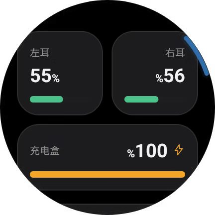
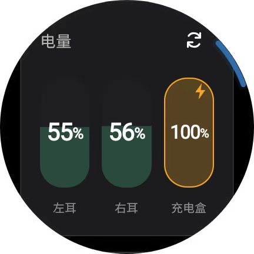
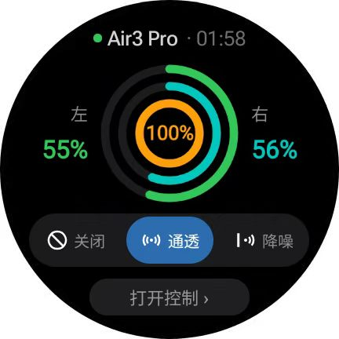
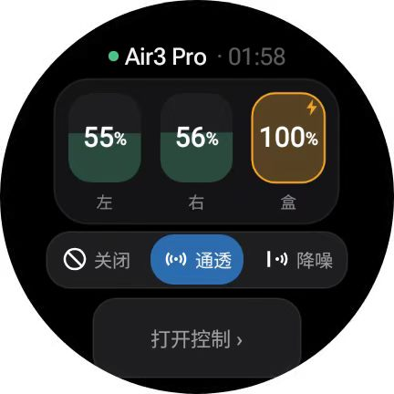
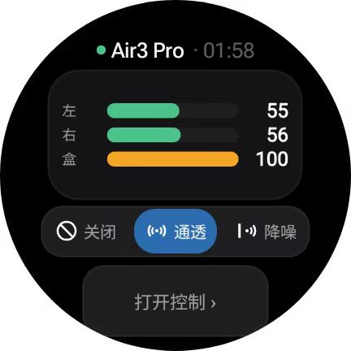

# WearEars 🎧⌚

> 原项目名`tws-control-for-wear`，现已重构并更名为**WearEars**。

[](https://github.com/hdzw1155/WearEars/releases)
[](https://github.com/hdzw1155/WearEars/blob/main/LICENSE)


在**Wear OS 3+手表、Android 11+手机、智能眼镜/XR头显、Android TV与Windows 10/11电脑**上跨品牌查看TWS蓝牙耳机电量、切换降噪与音效的开源工具（Android应用ID：`com.hdz.wearcontrol`，当前版本：`0.5.0`/`versionCode 19`，最低API 30、目标API 34）。所有通信仅走本地蓝牙与私有局域网，不连公网、不依赖云端、不收集也不上传任何数据。

> ⚠️ **风险提示**：本项目部分品牌协议来自社区逆向资料，并包含大量AI辅助编写的代码。私有蓝牙指令未经原厂授权，切换实验性功能或响铃寻机时存在突发爆音、音量突变、固件异常甚至损坏设备的风险。**首次试用新机型或点击标有「实验」的功能前，请务必摘下耳机并调低系统音量。**

---

## 0.5.0大版本更新了什么

从`0.4.x`跨到`0.5.0`，这次算是一次从手表小工具走向多端跨品牌控制器的完整重构。同时，发布前我们前前后后对协议栈、状态机、听觉安全门禁、局域网协同和Android/Windows双端做了**两大轮对抗性审查**，并补齐了数十万项自动化健壮性测试，修掉了一大批关链竞态、通道抢占、音频限幅和边界崩溃隐患，这版的Bug应该会比之前少很多了。

1. **全新Windows 10/11独立单文件桌面版（免装Java，约22.5MB）**
   - 内置精简Java运行环境、全部9大品牌协议驱动与原生Windows蓝牙RFCOMM桥接，下载单个`WearEars-0.5.0-Windows.exe`直接双击就能用，内置单实例互斥唤醒，避免重复启动抢占通道。
   - **系统托盘常驻与实时电量徽章**：常驻任务栏通知区，支持「耳机图标/实时最低耳电量数字徽章」双样式（低电量≤20%变红）、悬停显示左右耳与充电盒电量、低电量一次性气泡提醒（回充≥30%自动复位），左键单击直接从任务栏上方弹出控制卡片，右键带快捷降噪与设置菜单。
   - **1:1复刻Android四套皮肤与完整设置**：同样支持至上主义、新极简、新经典、新液位四套皮肤、中英文热切换、蓝牙自动优选并连接在线耳机、开机自启动、**原生Win32全局快捷键**（`Ctrl+Alt+W/N/A/T/O`随时呼出面板或切降噪，绝不给查找耳机绑热键）、**蓝牙断连阶梯退避自动重连守护**（手动断开即静默抑制），以及360°双耳试听实验室。
2. **多端形态引擎、纯黑光波导双栏HUD与Android快捷设置磁贴**
   - Wear OS 3+手表、Android 11+手机、智能眼镜/XR头显与Android TV共用同一个APK。内置纯Java 11形态判定引擎，自动识别圆表、手机（480dp居中列）与非触屏横屏HUD，也可在设置页手动切换显示形态。
   - **纯黑光波导双栏HUD**：面向智能眼镜、XR与大屏采用`#000000`纯黑底色、0dp直角深炭卡片与高对比聚焦描边，支持镜腿、遥控器与蓝牙智能戒指DPAD导航及快捷键（`1/2/3`切降噪/通透/关、`R/Menu`刷新、`MediaNext/ChannelUp`循环切降噪）。
   - **Android下拉快捷设置磁贴**：下拉通知栏即可看到最近状态，只读本地缓存、零后台蓝牙常连耗电，点按直达主控制页（兼容Android 11-14）。
3. **纯局域网多端本地互联、应用层内网防火墙与独立开发者选项**
   - 同局域网内由一台已连耳机的手机、手表或Windows电脑开启「主机共享」，其余设备切为「从机遥控」，免去多端争抢同一蓝牙RFCOMM通道的冲突（UDP 19846局域网发现+TCP 19845四位动态PIN校验，默认关闭、零云端）。
   - **应用层内网防火墙（Android与Windows共用核心规则）**：支持仅同子网`/24`、私有IP白名单、认证失败限流封禁、独立只读观察模式（与过滤总开关解耦独立生效）、待认证连接容量上限、策略撤销即时踢断与审计日志。
   - 局域网互联、内网防火墙、本机应用联动（Tasker/MacroDroid）以及新增的**一键脱敏诊断报告**（自动剥离MAC、完整IP、PIN与设备昵称，一键复制用于排查新机型兼容问题）统一收纳进「设置→开发者选项」。
4. **同品牌手机「快撤按需短连接」（解决系统服务秒踢断连）**
   - 针对ColorOS/OriginOS/HyperOS/HarmonyOS同品牌手机自带耳机服务优先级更高、1~2秒踢掉第三方RFCOMM导致界面「已连接↔未连接」反复闪跳的问题，手机端默认启用900ms/450ms快撤按需短连接与被踢软吸收：同步完成后主动归还通道保留界面快照，点击控制再自动唤醒，配合12秒稳定存活门禁避免重连耗电风暴（手表端保持常连，异品牌手机可在设置页切回长连接）。
5. **通用特性引擎：9大品牌进阶能力直接上主屏**
   - 在基础三态降噪与电量之外，统一建模了**降噪细分档位（与抗风噪独立槽位共存不互斥）、通透子模式、内置EQ/vivo DeepX、耳机硬件空间音频与头追、游戏低延迟、双设备连接、入耳佩戴检测、查找耳机、固件版本**。
   - 不再把EQ与空间音频藏在深层隐藏入口，按耳机实际回包探测结果直接展示；未全量真机验收项统一标「实验」徽章并配首次操作安全提示。
6. **本机单端空间音频DSP与360°双耳HRTF试听实验室**
   - 明确区分「耳机硬件空间音频」与「本机单端空间音频」，本机单端DSP基于Android `DynamicsProcessing`、会话级`EnvironmentalReverb`与`Virtualizer`，任意蓝牙耳机可用，检测到耳机硬件空间音频或系统`Spatializer`开启时自动旁路防叠加，音乐暂停45秒后自动释放降低耗电。
   - 内置纯Java 11零GC 48kHz双耳声学内核与内置试听音源，手表支持表冠15°刻度旋转，手机与Windows桌面端支持直接拖拽定位。
7. **四套皮肤全端统一与安全/省电底线**
   - **至上主义、新极简、新经典、新液位**四套界面覆盖主屏、设置、空间实验室、弹窗与Windows桌面端，支持中英文切换与日夜适配，修复了Android 11手机`AppScrollView`启动空指针闪退与Neo磁贴电量清零问题。
   - **听觉安全红线**：查找耳机响铃保留入耳佩戴硬拦截、发声前二次确认、30秒自动停响与放回耳中/断连急停，且全链路硬拦截局域网、外部Intent与Windows全局热键远程触发；保留70%音量护栏（进入与离开自动上锁）。
   - **省电治理**：Android端零WakeLock、零常驻前台服务、零后台BLE扫描，切后台即断链停动画，手机端跳过Wear OS磁贴蓝牙广播唤醒。

---

## 📸 界面预览

> 下图为早期手表端实拍参考，`0.5.0`在此基础上统一了至上主义、新极简、新经典、新液位四套皮肤，并同步覆盖手机竖屏、纯黑双栏HUD与Windows托盘浮窗。

<table>
  <tr>
    <td><br><div align="center">经典主界面</div></td>
    <td><br><div align="center">极简主界面</div></td>
    <td><br><div align="center">液位主界面</div></td>
  </tr>
  <tr>
    <td><br><div align="center">经典磁贴</div></td>
    <td><br><div align="center">液位磁贴</div></td>
    <td><br><div align="center">极简磁贴</div></td>
  </tr>
  <tr>
    <td colspan="3" align="center"><br/><div align="center">设置页参考</div></td>
  </tr>
</table>

---

## 📊 品牌支持与验证边界

请区分三类来源：**历史真机验证基线**（实测通过的基础链路与降噪/电量）、**开源资料扩展**（细分档位/抗风噪/EQ/扩展开关，未逐一真机验收前一律视为实验性），以及**标准蓝牙兜底**。

| 耳机品牌 | 传输方式 | 基础控制（降噪/电量） | 扩展特性（按探测开放，多为实验性） | 验证状态 |
| --- | --- | --- | --- | --- |
| **vivo/iQOO** | RFCOMM (GAIA) | 三态降噪/左中右电量 | 降噪档位、DeepX/EQ、空间音频、低延迟、佩戴、查找、固件 | ✅ 历史真机：vivo TWS Air3 Pro（含Windows直连与低延迟回执实测） |
| **华为FreeBuds/荣耀HONOR** | RFCOMM (SPP) | 三态降噪/左中右电量（含充电） | 降噪档位、抗风噪、通透人声、内置EQ、低延迟、佩戴、空间音频（HONOR隔离不发不兼容帧） | ✅ 历史真机：FreeBuds 6i、SE 4 ANC、HONOR Earbuds X9 |
| **小米/Redmi Buds** | RFCOMM (RCSP/MMA) | 按型号确认三态/左中右电量 | 降噪档位、自适应、通透、低延迟、双设备、佩戴、查找、空间音频（6 Play/6 Active禁用降噪） | ✅ 历史真机：Redmi Buds 6；其余型号实验性 |
| **OPPO/一加/realme** | RFCOMM (OPOv1) | 三态降噪/左中右电量（含充电） | 降噪档位、抗风噪（经能力回包确认后开放）、EQ、空间音频、低延迟、佩戴、查找 | ✅ 历史真机：Enco Air5 Pro、Enco Free4 |
| **原道NiceHCK** | RFCOMM (SPP) | 三态降噪/左中右电量 | 降噪深度、抗风噪等（按固件版本门控） | ✅ 历史真机：OriG in原道原点 |
| **Sony指定WH/WF** | RFCOMM (MDR V1/V2) | 回包确认三态/整机或分体电量 | 通透/语音聚焦、佩戴检测、多点等（按V2能力探测） | ✅ 历史真机：WF-1000XM5；其余候选型号实验性 |
| **漫步者EDIFIER** | RFCOMM (SPP)/BLE GATT | 按group映射（未知只读）/电量 | 降噪深度、抗风噪、低延迟 | ⚠️ 实验性（社区资料实现，未真机验证） |
| **弱水时砂RoseLink** | BLE GATT/RFCOMM | 按型号族映射/左中右电量 | 入耳检测、低延迟等 | ⚠️ 实验性（社区资料实现，未真机验证） |
| **Technics EAH-AZ** | RFCOMM (RACE) | 回包确认三态/左中右电量 | 降噪/通透强度等（不含A800） | ⚠️ 实验性（社区资料实现，未真机验证） |
| **其他蓝牙耳机** | 系统蓝牙Profile+广播 | 仅整机总电量（只读，不发私有指令） | 支持本机单端空间音频与360°实验室 | ⚠️ 标准兜底 |

> 9个品牌驱动均可在构建期按需裁剪，未知品牌或无私有链路时自动退回系统标准蓝牙状态，不会向陌生耳机盲发私有指令。

---

## 🚀 安装与使用

请前往[Releases](https://github.com/hdzw1155/WearEars/releases)下载最新正式版：

### Android端（手表/手机/智能眼镜/XR/TV共用`WearEars-0.5.0.apk`）

1. **先配对耳机**：在手表或手机的系统蓝牙里正常连上耳机（若使用局域网「从机遥控」模式，仅需在主机端连耳机）。
2. **安装APK**：
   - **Android手机/智能眼镜/XR/TV**：直接安装或通过`adb install -r WearEars-0.5.0.apk`侧载。
   - **Wear OS手表**：用手机上的**WearOS工具箱**/水滴助手/Bugjaeger无线调试安装，或电脑执行`adb install -r WearEars-0.5.0.apk`。
   - **两个常见安装坑**：
     1. 反复下载同名包时，手机或工具箱可能会把文件重命名为`.apk.1`，ADB会直接拒装，请确保文件名以`.apk`结尾。
     2. 官方Release发布的`WearEars-0.5.0.apk`延续了`v0.4.x`与`v0.5.0-exp*`官方签名，可直接覆盖升级；如果设备上装着自行编译的本地调试包并提示签名冲突，请先卸载旧版再装新版。
3. **首次启动与磁贴**：首次打开或跨`versionCode`升级需确认免责声明；手表端可在磁贴列表添加「耳机控制」磁贴，手机端可在下拉快捷设置面板添加WearEars快捷磁贴。

### Windows端（Windows 10/11 64位使用`WearEars-0.5.0-Windows.exe`）

1. 在Windows蓝牙设置中正常配对并连接耳机。
2. 下载单个`WearEars-0.5.0-Windows.exe`直接双击运行（无需安装Java，首次启动会自动静默释放运行缓存到`%LOCALAPPDATA%\WearEars-Desktop\`，后续双击秒开）。
3. 启动后会常驻任务栏右下角通知区（`^`隐藏图标面板，可拖到任务栏固定显示）：悬停查看电量，左键弹出/收起控制卡片，右键快捷切降噪或打开设置。

---

## 🛠️ 在Windows离线构建与裁剪驱动

开发与架构详情请先看[底层架构与交接](docs/HANDOFF.md)和[按问题查文件](docs/FILE_MAP.md)。

环境要求：Python 3.9+（`py`启动器）、JDK 17、Android SDK Platform 34、Build Tools 34.0.0（桌面端蓝牙桥使用Windows内置.NET Framework 4.x `csc.exe`，单文件打包使用JDK `jpackage`与系统内置`iexpress.exe`）。默认JDK目录`%USERPROFILE%\android-tools\jdk-ms`，SDK目录`%LOCALAPPDATA%\Android\Sdk`（可用环境变量`WEAREARS_JDK`和`ANDROID_SDK_ROOT`覆盖）。Wear Tiles等离线jar已随仓附带，无需联网拉取Gradle依赖。

```powershell
# 运行纯核心规则单测
py -X utf8 build.py core

# 运行全部19套Android/核心/9大驱动自动化测试（含87472项协议健壮性压测、401项脱敏诊断检查、480029项空间音频DSP检查与331组中英文文案对等检查）
py -X utf8 build.py test

# 全量测试 + 构建APK + zipalign + apksigner签名校验（产物：build/WearEars.apk）
py -X utf8 build.py verify

# Windows桌面端全量编译 + 795项桌面单测 + 蓝牙桥冒烟 + 独立单文件EXE打包（产物：build/desktop/WearEars-Windows.exe）
py -X utf8 desktop/build_desktop.py verify
```

按需裁剪品牌驱动打包：

```powershell
py -X utf8 build.py apk --drivers none
py -X utf8 build.py apk --drivers vivo,huawei,xiaomi,oppo
```

首次构建会在`.local/debug.p12`生成本地调试密钥（不入库）。如需自定义发布签名，可设置`WEAREARS_KEYSTORE`、`WEAREARS_KEY_ALIAS`、`WEAREARS_STORE_PASS`（必要时加`WEAREARS_KEY_PASS`）。

---

## ⚠️ 免责声明与开源致谢

- 本项目为非官方第三方社区开源工具，仅供个人学习与技术交流，与vivo/华为/荣耀/小米/OPPO/一加/realme/漫步者/弱水时砂/原道/Sony/Technics及其关联公司无任何隶属或授权关系。
- 按现状提供，不作任何明示或默示担保；因使用本项目引发的设备异常、听力不适或保修问题由使用者自行承担。
- 协议资料参考自开源社区公开逆向文档与项目：TWS-Pods-PC、HyperEars、Pods-Protocol-Reverse、QuickBuds、SonyHeadphonesClient、redmi-buds-linux、OpenXia、omarchy-headphones、RoseLink-Protocol、rosebuds、NiceHCK_Controller及其Windows实现、OpenFreebuds等。完整上游归属见[NOTICE](NOTICE)，离线依赖许可见[vendor/NOTICE.md](vendor/NOTICE.md)。
- 源码许可证：[MIT](LICENSE)。
